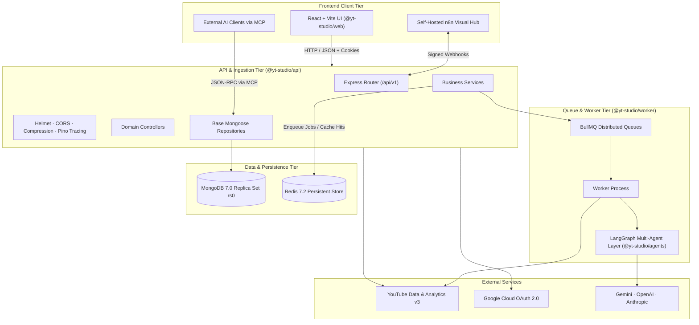
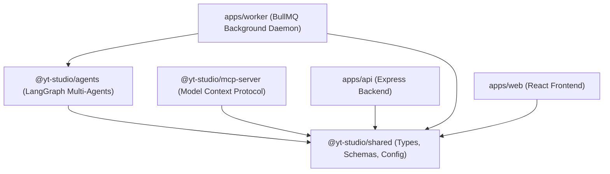
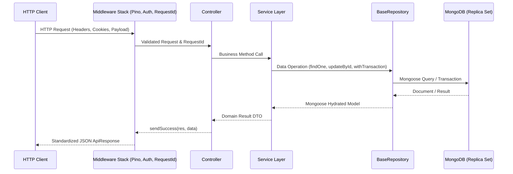
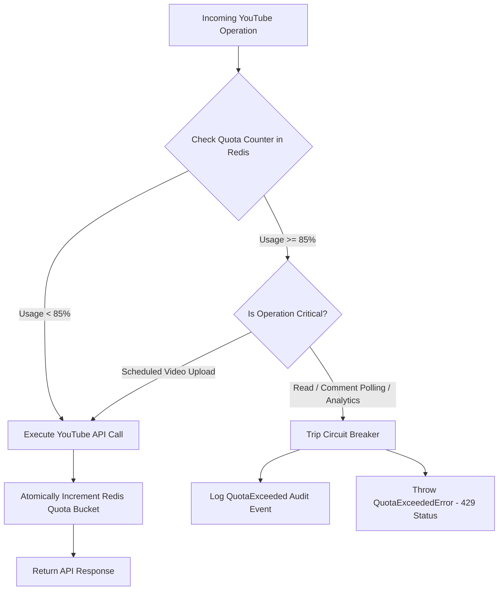
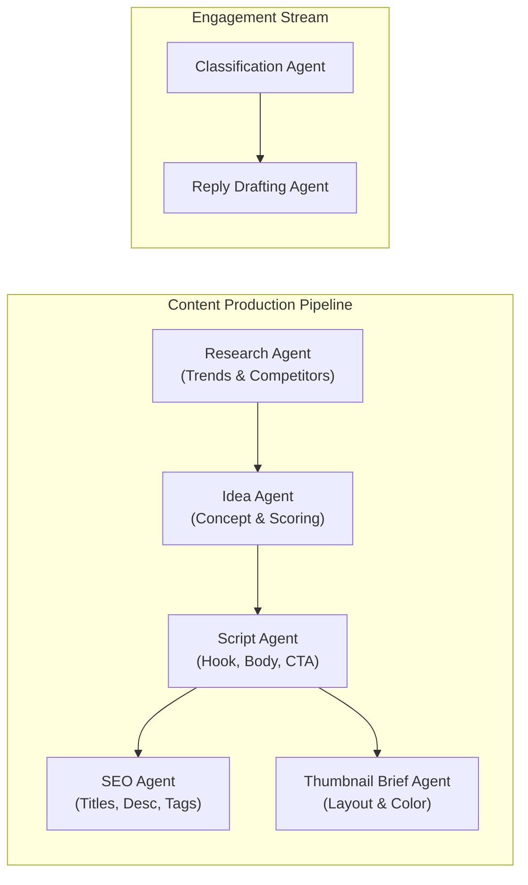

# System Architecture Specification (v1.0) — YT Automation Studio

**Document Version:** 1.0.0  
**Status:** Approved Architectural Baseline  
**Author:** Principal System Architect  
**Related Documents:** [PRD.md](file:///c:/Projects/Youtube%20Automation%20Studio/docs/PRD.md) · [SETUP.md](file:///c:/Projects/Youtube%20Automation%20Studio/docs/SETUP.md) · [IMPLEMENTATION_PLAN.md](file:///c:/Projects/Youtube%20Automation%20Studio/docs/IMPLEMENTATION_PLAN.md)

---

## 1. High-Level Architectural Overview

**YT Automation Studio** is structured as an enterprise-grade distributed monorepo. It orchestrates high-volume YouTube content pipelines, human-in-the-loop engagement moderation, AI multi-agent content generation, and scheduled publishing through a decoupled event-driven architecture.



---

## 2. Monorepo Package Decomposition

The repository is managed with **pnpm workspaces** and **Turborepo** for isolated caching and fast parallel execution:

```
/
├── apps/
│   ├── web/           # React 19 + Vite + Tailwind + Google Stitch UI
│   ├── api/           # Express 4 + TypeScript layered backend service
│   └── worker/        # BullMQ background job processor and uploader
├── packages/
│   ├── shared/        # Single source of truth: Zod schemas, domain types, config validation
│   ├── agents/        # LangGraph multi-agent teams (Research, Script, SEO, Moderation)
│   └── mcp-server/    # Model Context Protocol server exposing platform tools
├── infra/
│   ├── docker/        # Docker Compose manifests (MongoDB rs0, Redis, n8n)
│   └── ci/            # Automated workflow validation scripts
└── docs/              # 15 core documentation files & in-app Docs renderer
```

### 2.1 Package Dependency Graph



---

## 3. Backend Layered Architecture

`apps/api` follows a strict layered separation of concerns to prevent circular dependencies, ensure testability, and decouple database operations from HTTP semantics:



### Architectural Roles:
1. **Routes (`src/routes/`):** URL mapping, versioning (`/api/v1`), and middleware binding.
2. **Middlewares (`src/middlewares/`):** Request correlation ID tracing, Pino logging with secret redaction, Helmet security headers, CORS, Zod schema validation, and centralized error catching.
3. **Controllers (`src/controllers/`):** Extract request parameters, invoke domain services, and return typed `ApiResponse<T>` envelopes.
4. **Services (`src/services/`):** Domain logic, quota calculations, business rule enforcement, event dispatching, and external API coordination.
5. **Repositories (`src/repositories/`):** Abstract data access layer extending `BaseRepository<T>`, providing typed CRUD, pagination calculations, soft-delete filtering, and ACID transactions via `withTransaction`.

---

## 4. YouTube API Quota Engine & Circuit Breaker

The platform operates under YouTube Data API v3 quota constraints (default: **10,000 units/day** per Google Cloud project).

### 4.1 Cost Matrix
- **Resumable Video Upload:** `1,600 units`
- **Search / List Queries:** `100 units`
- **Metadata / Thumbnail Mutations:** `50 units`
- **Standard Read / List Calls:** `1 unit`

### 4.2 Circuit-Breaker Architecture



- **Quota Tracking:** Stored in Redis with atomic `INCRBY` operations, tagged by `workspaceId` and date (Pacific Standard Time PST/PDT, matching Google's daily quota reset cycle at midnight).
- **Graceful Degradation:** When workspace quota hits **85%** (8,500 units), non-essential background tasks (trend syncing, comment polling, analytics refreshes) are paused to guarantee that scheduled video uploads complete without disruption.

---

## 5. Multi-Agent AI Layer (LangGraph Architecture)

The AI content pipeline uses specialized multi-agent teams running on LangGraph behind a unified provider-agnostic interface:



### 5.1 Auditability Mandate
Every LLM call logs an `AIGenerationAudit` record to MongoDB:
- Prompt snapshot & model version (e.g. `gemini-2.0-flash`, `gpt-4o`)
- Execution duration & latency in milliseconds
- Exact token usage (`promptTokens`, `completionTokens`, `totalTokens`)
- Calculated monetary cost in USD

---

## 6. Asynchronous Queue Processing (BullMQ)

High-latency tasks (video uploads, chunked media processing, comment batch sync, AI generation) are offloaded to BullMQ workers:

- **Redis Reliability:** Configured with `appendonly yes` and `maxmemory-policy noeviction`. Queued jobs are never evicted under memory pressure.
- **Idempotency:** Every job receives an idempotency key (`workspaceId:channelId:action:entityId`) preventing double-uploads.
- **Chunked Resumable Upload:** 5MB chunk buffers with exponential backoff retrying network drops during long 4K video uploads.
- **Dead-Letter Queue (DLQ):** Unrecoverable failures are parked in a dead-letter queue with structured error metadata for developer inspection.

---

## 7. Security, Token Encryption & RBAC

### 7.1 OAuth Token Encryption at Rest
All Google OAuth access and refresh tokens are encrypted using **AES-256-GCM**:
- A 256-bit master key (`TOKEN_ENCRYPTION_KEY_HEX`) is injected via environment variables.
- Every encryption operation generates a unique random 16-byte Initialization Vector (IV).
- The resulting ciphertext, 16-byte authentication tag, and IV are stored in MongoDB as an `EncryptedToken` object.
- Tokens are decrypted in memory only when signing YouTube API requests and are never written to unencrypted logs or responses.

### 7.2 Zero Secret Logging
Pino's redaction engine automatically strips:
`req.headers.authorization`, `req.headers.cookie`, `*.password`, `*.token`, `*.secret`, `*.refreshToken`, `*.accessToken`, `*.apiKey`.

### 7.3 Multi-Tenant RBAC Permissions Matrix

| Platform Action | Owner | Admin | Editor | Viewer |
| :--- | :---: | :---: | :---: | :---: |
| Manage Workspace Billing & Seats | ✅ | ❌ | ❌ | ❌ |
| Connect / Disconnect Channels | ✅ | ✅ | ❌ | ❌ |
| Configure n8n Automation Workflows | ✅ | ✅ | ❌ | ❌ |
| Create / Edit Video Scripts & SEO | ✅ | ✅ | ✅ | ❌ |
| Approve AI Comment Replies | ✅ | ✅ | ✅ | ❌ |
| Schedule & Publish Video Uploads | ✅ | ✅ | ✅ | ❌ |
| View Analytics, Pipelines & Audit Logs | ✅ | ✅ | ✅ | ✅ |

---

## 8. Extensibility: n8n & MCP Server

### 8.1 Visual Automation (n8n Integration)
- Self-hosted n8n container deployed in Docker Compose network `yt-network`.
- Triggers outbound signed webhooks on platform events (`video.published`, `comment.flagged`, `quota.circuit_breaker`).
- Listens to inbound automation actions from external creator workflows.

### 8.2 Model Context Protocol (MCP) Server
- Exposes platform tools (`list_videos`, `get_channel_analytics`, `draft_video_script`, `update_video_metadata`, `schedule_publish`) to external AI clients (Claude Desktop, Antigravity) via JSON-RPC.
