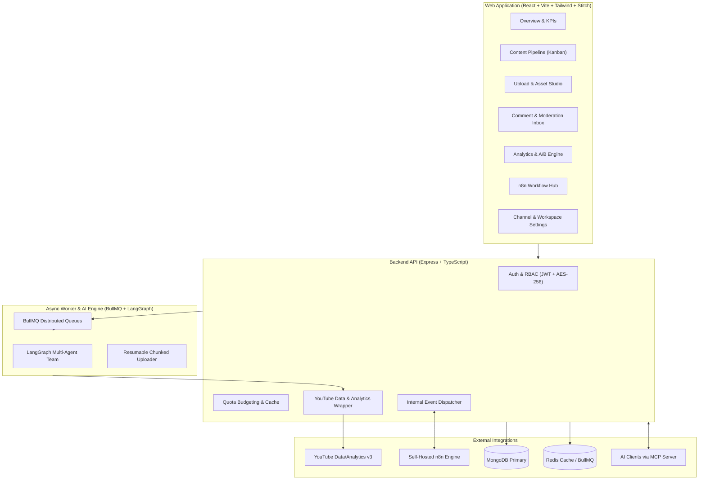

# Product Requirements Document (PRD) — YT Automation Studio

**Document Version:** 1.0.0  
**Status:** Approved / Foundation Baseline  
**Author:** Principal System Architect & Full-Stack Engineer  
**Target Release:** Production v1.0  

---

## 1. Executive Summary & Product Vision

### 1.1 Vision Statement
**YT Automation Studio** is an enterprise-grade YouTube automation, operations, and intelligence platform built on the MERN stack (MongoDB, Express, React, Node.js), BullMQ, n8n visual automation, and LangGraph-powered AI agent teams. 

Designed for professional creators, multi-channel media networks, and digital marketing agencies, YT Automation Studio consolidates the fragmented YouTube toolchain into a single, cohesive, secure command center. It orchestrates the full lifecycle of YouTube production: competitive niche research, ideation, scriptwriting, thumbnail briefing, SEO optimization, resumable video uploading, scheduled publishing, human-in-the-loop comment moderation, deep performance analytics, and A/B split-testing.

### 1.2 Core Value Proposition
- **Unified Multi-Channel Operations:** Manage 1 to 50+ channels across separate workspace boundaries with fine-grained Role-Based Access Control (RBAC).
- **Intelligent Quota Safety:** A deterministic quota-budgeting engine that guards against YouTube API exhaustions (10,000 standard daily units) via intelligent caching, batched requests, and graceful degradation.
- **Agentic Pipeline with Auditability:** Multi-agent LangGraph orchestrations (Research, Script, SEO, Thumbnail Brief, Moderation, Analytics) where every single model run is permanently tracked with prompt snapshot, model version, latency, and monetary cost.
- **Strict Compliance & Brand Safety:** 100% compliant with YouTube API Services Terms and Developer Policies. Absolutely zero fake engagement, artificial traffic, or botting. Automated comment replies are held in a human-approval queue by default.
- **Extensible Automation:** Native bi-directional hooks with self-hosted n8n workflows and an embedded Model Context Protocol (MCP) server allowing AI clients to interface directly with studio tools.

---

## 2. Target Personas & User Scenarios

### Persona A: The Pro Creator / Solopreneur ("Marcus")
* **Profile:** Runs 1–3 monetized channels (tech tutorials and productivity). Produces 2 long-form videos weekly and daily Shorts.
* **Pain Points:** Spends 15+ hours weekly on research, keyword analysis, rendering descriptions, tags, and replying to repetitive comments. Struggles to systematically test thumbnails and titles.
* **Key Needs:**
  - Fast idea validation and structured script generation matching his unique tone of voice.
  - One-click upload and scheduled release with pre-computed SEO metadata.
  - Streamlined comment triage highlighting super-fans, questions, and spam.
  - Automated thumbnail A/B testing with statistical significance indicators.

### Persona B: The Digital Media Agency / Multi-Channel Network ("Aura Media")
* **Profile:** 12 team members managing 25 client channels across diverse verticals (gaming, finance, e-commerce, education).
* **Pain Points:** Complex client permission management, credential sharing risks, disjointed Slack/Notion pipelines, frequent YouTube quota exhaustion, and lack of client-facing analytics exports.
* **Key Needs:**
  - Multi-tenant workspaces with RBAC (`Owner`, `Admin`, `Editor`, `Viewer`).
  - Strict OAuth isolation: clients connect their channels via Google OAuth without ever sharing passwords.
  - Centralized team approval gates before scripts, metadata, or uploads go live.
  - Quota pooling and threshold alerting across all managed channels.
  - Automated PDF/CSV client reporting on monthly reach and subscriber growth.

### Persona C: The Faceless / Automated Channel Architect ("Elena")
* **Profile:** Operates 8 automated documentary and educational channels leveraging remote voiceover artists and stock footage editors.
* **Pain Points:** Managing brittle Zapier/Make automations that break silently, lack of centralized status tracking, and poor error recovery on upload failures.
* **Key Needs:**
  - Robust visual workflow automation powered by self-hosted n8n triggered by platform events (e.g., `video.drafted`, `asset.uploaded`).
  - Resumable video upload pipelines with BullMQ queue recovery for 4K video files.
  - Batch generation of thumbnail design briefs and title variants for external editors.
  - Programmatic access via MCP and REST APIs to plug in custom rendering pipelines.

---

## 3. Product Scope & Functional Modules

### 3.1 Workspace & Channel Management
* **Multi-Tenancy:** Users belong to one or more Workspaces. Workspaces own Channels, Content Pipelines, Workflows, and Assets.
* **Channel Linking:** Seamless Google OAuth 2.0 flow requesting granular YouTube scopes (`youtube.readonly`, `youtube.upload`, `youtube.force-ssl`, `yt-analytics.readonly`).
* **Multi-Channel Switching:** Global switcher in the navigation bar to toggle between active channels or view an aggregated workspace dashboard.
* **Audit Logging:** Every user mutation (channel disconnect, permission change, video update, quota override) is logged with timestamp, user ID, IP, and payload diff.

### 3.2 AI Multi-Agent Content Pipeline
The pipeline operates on a stateful Kanban model (`Idea` → `Research` → `Scripting` → `Asset Prep` → `SEO & Review` → `Scheduled` → `Published`):
1. **Research Agent:** Performs competitor analysis, trend scraping, search intent clustering, and niche content gap detection.
2. **Idea Generation Agent:** Scores candidate concepts using novelty, virality potential, production complexity, and brand fit scores (1–100).
3. **Script Agent:** Crafts complete three-act or educational video structures including the 5-second hook, retention anchors, visual b-roll cues, and conversion-focused Call to Action (CTA).
4. **Thumbnail Brief Agent:** Produces detailed composition, color palette, visual hierarchy, focal points, and typography briefs for thumbnail artists.
5. **SEO Agent:** Generates CTR-optimized title candidates (under 60 chars), algorithmic descriptions with timestamps, target tag bundles, and video category mapping.
6. **Channel Voice & Memory:** Vectorized and parameterized brand voice profiles (tone, banned words, standard disclaimers, signature humor style) passed to every agent prompt.
7. **Cost & Run Transparency:** Stores prompt, completion tokens, execution time, model provider (OpenAI, Anthropic, Gemini), and exact USD cost for every generation.

### 3.3 YouTube API Quota & Rate-Limiting Engine
* **The 10,000 Units/Day Rule:** Default YouTube API projects receive 10,000 units/day. A video upload costs 1,600 units; a search costs 100 units; a write/update costs 50 units; read list calls cost 1 unit.
* **Quota Allocation Engine:**
  - Workspaces define reserve pools (e.g., 60% reserved for scheduled uploads = 3 uploads/day, 20% for comment sync, 20% for analytics/metadata).
  - Quota counters are stored in Redis with atomic increments and TTL expiring at midnight Pacific Time (PST/PDT).
  - Circuit Breaker: When usage reaches 85% of daily quota, non-essential operations (comment polling, trend refresh) pause automatically, preserving quota for critical scheduled video uploads.
* **Cache Strategy:** Aggressive Redis caching for channels (TTL: 24h), playlists (TTL: 6h), and static video metadata (TTL: 1h). Read operations hit local MongoDB replica before touching YouTube API.

### 3.4 Upload & Scheduling Studio
* **Resumable Chunked Upload:** Direct streaming from worker storage to YouTube's resumable upload endpoint using 5MB chunk buffers with exponential backoff on network interruption.
* **Publish Scheduling:** Exact-time scheduling supporting private/unlisted staging, premier status, and public publish triggers.
* **Asset Vault:** Secure storage for video source files, raw thumbnail PSDs/PNGs, subtitle SRT files, and generated graphics.

### 3.5 Human-in-the-Loop Engagement & Moderation
* **Comment Stream:** Automated periodic synchronization of top-level comments and replies.
* **Classification Agent:** Categorizes incoming comments into *Praise*, *Technical Question*, *Video Idea*, *Constructive Critique*, *Spam/Self-Promotion*, and *Hate/Abuse*.
* **Draft Generation:** Suggests on-brand, personalized replies for human review.
* **Human Approval Gate:** Replies are **never posted autonomously by default**. The creator or moderator clicks "Approve & Send" or edits inline. A deliberate opt-in toggle for auto-replying exists only for whitelisted safe templates (e.g. "Thanks for watching!").

### 3.6 Analytics & A/B Split-Testing Engine
* **Aggregated Metrics:** Views, Watch Time, Average View Duration (AVD), Audience Retention graphs, Impressions, and Click-Through Rate (CTR).
* **A/B Testing Framework:** Alternates title and/or thumbnail at predetermined intervals (e.g., every 24 hours or every 5,000 impressions), monitoring CTR and initial 48-hour velocity until a 95% Bayesian significance threshold is reached.
* **AI Diagnostic Reports:** Weekly AI-generated insights identifying retention drop-offs, high-performing topics, and recommended next uploads.

### 3.7 Visual Workflow Automation (n8n Integration)
* **Self-Hosted Engine:** n8n instance orchestrated via Docker Compose, isolated behind backend token authentication.
* **Bi-Directional Webhooks:**
  - Outbound triggers: `video.published`, `comment.flagged`, `quota.warning`, `ab_test.concluded`.
  - Inbound actions: Trigger pipeline runs from external RSS feeds, Google Sheets, or Telegram bots.
* **Pre-Built Templates:** Curated workflow blueprints (e.g., "Auto-Tweet New Video with AI Summary", "Discord Notification on High-Performing Video", "Slack Alert on Negative Sentiment Spike").

### 3.8 Model Context Protocol (MCP) Server
* Exposes platform capabilities to external AI interfaces (Claude Desktop, Antigravity, custom agents).
* Implements tools: `list_videos`, `get_channel_analytics`, `draft_video_script`, `update_video_metadata`, `schedule_publish`.

---

## 4. Non-Functional Requirements & Architecture Standards

### 4.1 Security & Cryptography
* **Zero Secret Exposure:** Zero logging of access tokens, refresh tokens, Google client secrets, or LLM API keys.
* **Encryption at Rest:** All OAuth tokens (refresh tokens and access tokens) encrypted using **AES-256-GCM** with unique initialization vectors (IVs) and authentication tags stored alongside ciphertext in MongoDB. Master encryption key managed via environment variables.
* **Authentication:** Stateless short-lived JWT access tokens (15-minute lifespan) paired with rotating refresh tokens stored in secure, `httpOnly`, `SameSite=Strict`, `Path=/api/v1/auth` cookies.
* **Role-Based Access Control (RBAC):**
  - `Owner`: Complete billing, workspace deletion, channel connection, role assignment.
  - `Admin`: Channel connection, workflow configuration, user invitations.
  - `Editor`: Scripting, metadata updates, upload initiation, comment approvals.
  - `Viewer`: Read-only access to analytics, pipelines, and audit logs.

### 4.2 Performance & Scalability
* **API Response Time:** p95 latency under 200ms for read endpoints; p99 under 500ms.
* **Async Processing:** All long-running tasks (LLM generations, YouTube API synchronization, media uploads) delegated to BullMQ workers backed by Redis.
* **Concurrency & Idempotency:** Idempotency keys enforced on all upload and mutation jobs to prevent duplicate uploads or double-billing.

### 4.3 YouTube API Terms of Service & Developer Policy Compliance
* **No Artificial Metrics:** No exchange systems, view swaps, or automated liking/subscribing.
* **Human Oversight:** Human-in-the-loop review for all community-facing actions.
* **Data Privacy:** Channel data is strictly segregated per workspace; user data is permanently deleted upon workspace cancellation or Google account disconnection.
* **Proper Attribution:** Clear display of YouTube branding assets and attribution in compliance with Google Developer Brand Guidelines.

---

## 5. Pricing Tiers & Usage Limits

| Feature Dimension | Starter ($29/mo) | Pro ($79/mo) | Agency ($249/mo) | Enterprise (Custom) |
| :--- | :--- | :--- | :--- | :--- |
| **Connected Channels** | 1 Channel | 3 Channels | 15 Channels | Unlimited |
| **Team Seats** | 1 Seat | 3 Seats | 10 Seats | Custom RBAC Seats |
| **Daily Video Uploads** | Up to 2 / day | Up to 6 / day | Up to 30 / day | Dedicated API Quota |
| **AI Generation Credits** | 100k tokens/mo | 500k tokens/mo | 2.5M tokens/mo | Custom Pool / Bring Your Own Key |
| **A/B Split-Testing** | 1 Active Test | 5 Active Tests | 25 Active Tests | Unlimited Concurrent |
| **n8n Workflows** | 2 Workflows | 10 Workflows | Unlimited | Dedicated n8n Instance |
| **Comment Moderation** | Manual AI Drafts | Auto-Classify + Drafts | Multi-Mod Queue + SLAs | Custom AI Guardrails |
| **API & MCP Access** | ❌ None | Standard MCP | Full REST + MCP | Dedicated Gateway & SLAs |

---

## 6. Success Metrics & Key Performance Indicators (KPIs)

1. **System Reliability:**
   - Platform uptime > 99.9%.
   - Zero quota blackouts (unhandled 403 `quotaExceeded` errors from YouTube).
   - Video upload completion rate > 99.5% on stable network connections.
2. **User Efficiency:**
   - 70% reduction in creator time spent from initial concept to scheduled upload.
   - 80% acceleration in comment triage speed using classification tags.
3. **Engineering Rigor:**
   - 100% strict TypeScript coverage (zero unchecked `any`).
   - > 85% unit test coverage for core business logic, services, and cryptographic utilities.
   - Clean, green CI on every phase transition.

---

## 7. Document Revision & Sign-off

| Date | Version | Description | Author | Status |
| :--- | :--- | :--- | :--- | :--- |
| 2026-11-24 | 1.0.0 | Initial comprehensive PRD baseline covering full 110-phase roadmap | Principal Architect | Approved |
